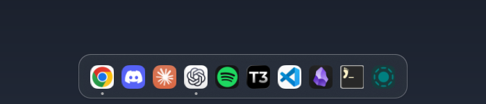

# Omarchy macOS Dock

A compact translucent dock for Omarchy, with a continuous magnification wave, running indicators and local application artwork.



## Behavior

- Auto-hides at the lower edge and appears as the pointer reaches it.
- Magnification moves neighboring icons smoothly using a continuous lens and inverse pointer mapping, avoiding layout feedback jitter.
- The glass background keeps its height during hover and launch feedback.
- Uses installed `.desktop` entries and the largest available original icon; adding an app does not require supplying an image.
- Adds a rounded plate only when the original artwork needs one; existing plates are preserved. Discord's mark is sized to avoid nested empty margins.
- Click to launch or focus. Right-click for window actions, pin ordering, removing a pin or adding another installed application.
- Runs on each connected monitor. Preferences live in `~/.config/quickshell/classic-dock/settings.json` and survive updates.

Default pins refer to Chrome, Discord, Claude, ChatGPT, Spotify, T3 Code, VS Code, Obsidian, Foot and LocalSend. Missing applications are omitted; use the dock's add-app menu to choose your installed alternatives. No applications are installed by this project.

Geometry: 34 px resting icons, up to 58 px magnification, 45 px resting pitch, 4 px running dots with a 5 px gap, and a 64 px translucent shelf. This recreates the visual behavior on Hyprland; it does not provide macOS window-to-dock Genie minimization.

## Get it

```sh
git clone https://github.com/saitakarcesme/Omarchy-MacOS-Dock.git
cd Omarchy-MacOS-Dock
```

Extra dependencies: ImageMagick, `gtk-launch`, `uwsm-app`. Icon preparation only writes a derived cache under `~/.cache/classic-dock`; source artwork is untouched.

## Requirements

This targets **Omarchy's Quickshell desktop and Hyprland Lua configuration**, tested with Hyprland 0.56.2, Quickshell 0.3.2 and Qt 6.12. Older Waybar/Walker Omarchy releases are not supported. Python 3 and the normal Omarchy command-line tools must be installed. The UI uses Inter (with the system font fallback if unavailable).

## Install / update

```sh
./install.sh --dry-run
./install.sh
```

Run as your normal desktop user, not root. The installer checks dependencies, backs up replaced files under `~/.local/state/`, writes only user configuration, and reloads the affected shell. Running it again updates the installation while retaining the original uninstall baseline. It never edits `/usr/share/omarchy` or installs packages automatically.

## Uninstall

```sh
./uninstall.sh
```

The installer restores original files, removes its marked Lua blocks and preserves unrelated settings. Locally modified source files are retained with a message; use `./uninstall.sh --force` only to discard those edits. Backups remain available. `--no-reload` is available for offline installation. Install the three companion projects in any order; each can also be used independently.

## Development

```sh
python3 tests/test_install.py
node tests/test_layout.js
```

The installer test uses a temporary home directory and never touches the real desktop. Test UI changes in a running Omarchy session; QML imports depend on the installed Omarchy shell.

## License and attribution

MIT; see [LICENSE](LICENSE) and [NOTICE](NOTICE). Portions derive from [Omarchy](https://github.com/basecamp/omarchy). Independent community work, not affiliated with or endorsed by Apple. No Apple fonts, SF Symbols, wallpapers, recordings or application icon packs are distributed. Applications retain their owners' branding and resolve their artwork from the local installation.

## Companion projects

- [OmarchyLight](https://github.com/saitakarcesme/OmarchyLight)
- [Omarchy-MacOS-MenuBar](https://github.com/saitakarcesme/Omarchy-MacOS-MenuBar)
